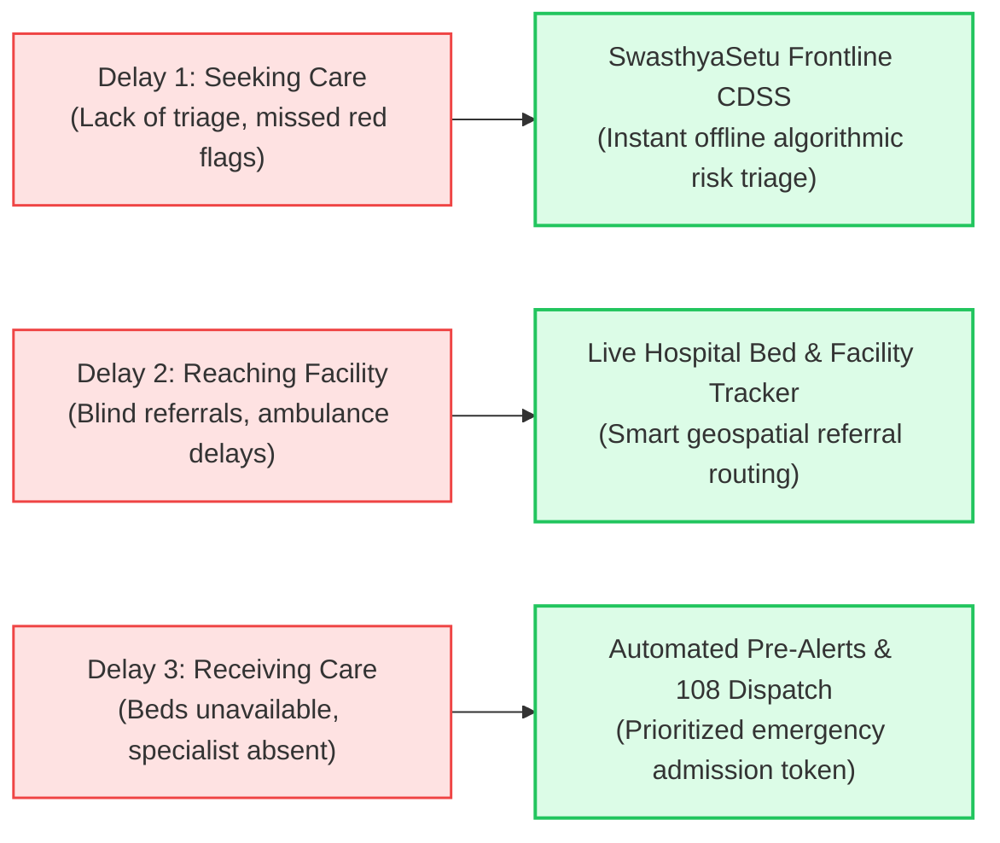
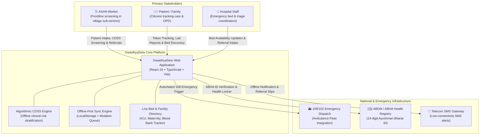
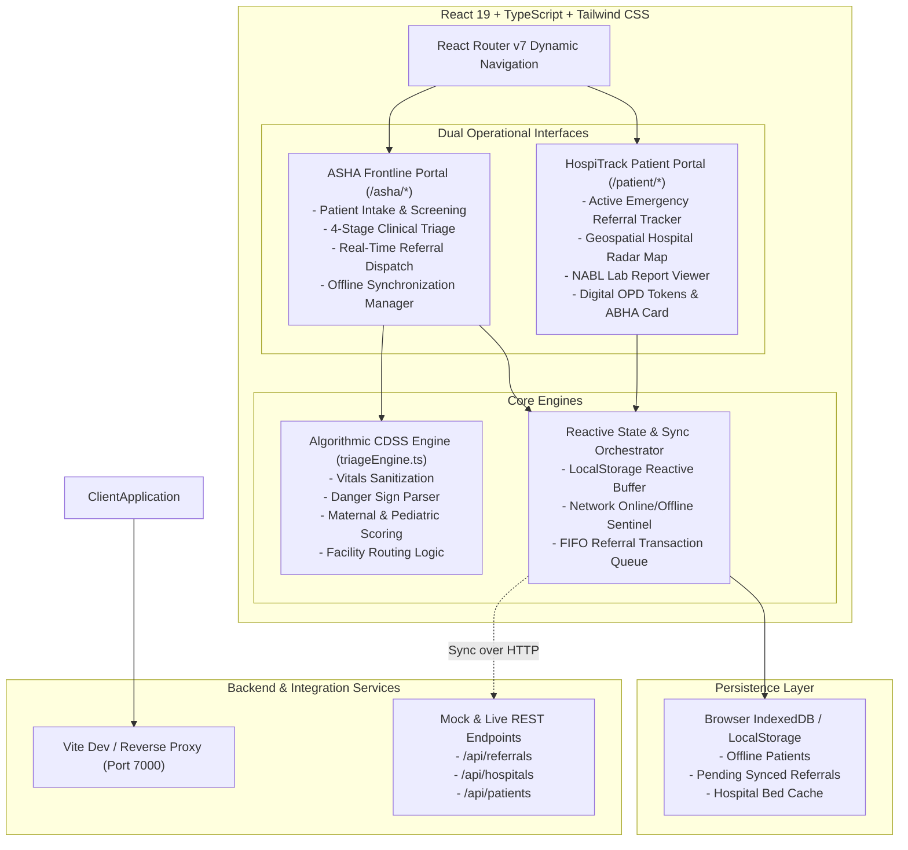
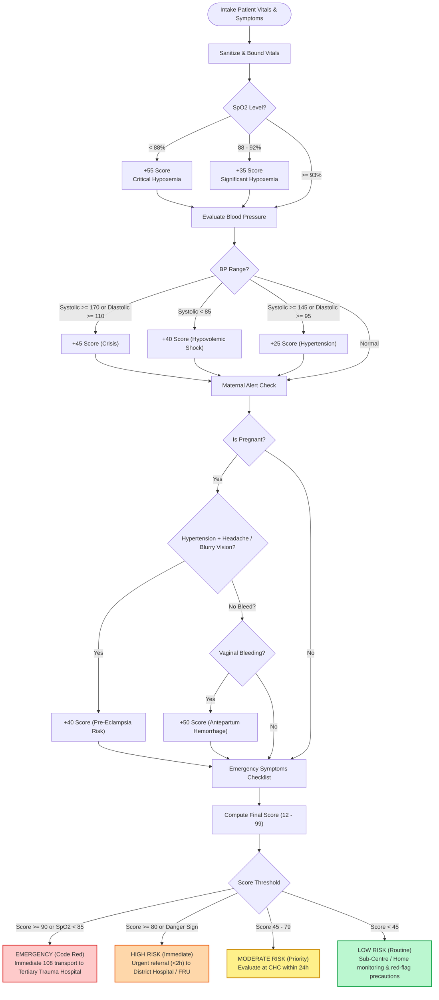
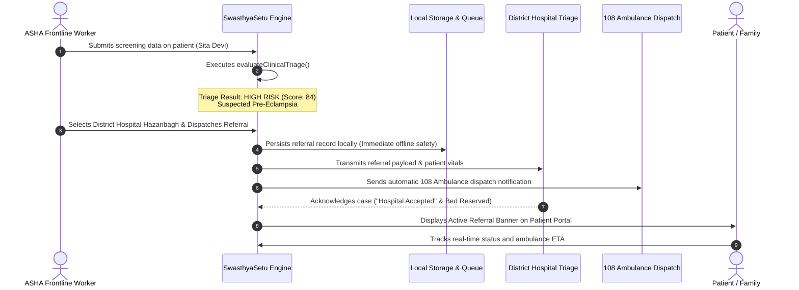
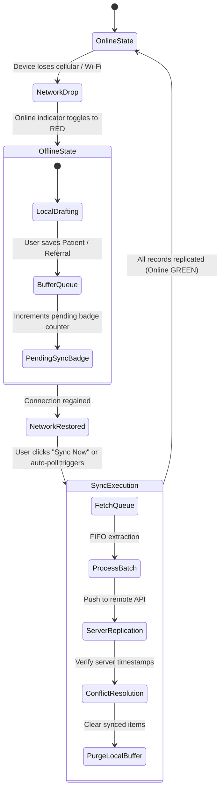
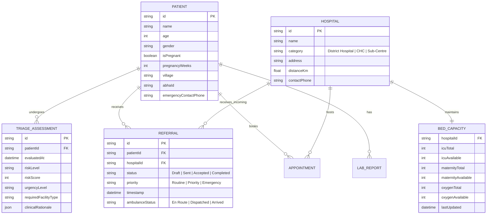

# SwasthyaSetu — Technical Design Document (TDD)

> **Frontline Clinical Decision Support, Offline-First Risk Stratification, and Unified Emergency Hospital Referral Network**  
> *Author:* Chandan & The SwasthyaSetu Team  
> *Version:* 1.0.0  
> *Date:* 2026-10-11  
> *Status:* Implemented & Verified

---

## 1. System Context & Problem Statement

Rural and maternal healthcare delivery across developing regions is disproportionately hampered by the **"Three Delays"** framework (Thaddeus & Maine):



**SwasthyaSetu** bridges the chasm between the frontline Accredited Social Health Activist (ASHA) in rural villages and tertiary emergency healthcare infrastructure through a progressive, offline-first digital continuum.

---

## 2. High-Level System Architecture

### 2.1 C4 Context Level Diagram



---

### 2.2 C4 Container & Component Architecture



---

## 3. Clinical Decision Support (CDSS) Specification

### 3.1 Vitals Sanitization & Bounding

Frontline data entry is prone to typographical errors under emergency field conditions. The CDSS normalizes inputs before evaluation:

| Vital Sign | Normal Range | Minimum Bound | Maximum Bound | Fallback Value |
| :--- | :--- | :--- | :--- | :--- |
| **SpO2 (%)** | 95% – 100% | 40% | 100% | 98% |
| **Systolic BP (mmHg)** | 110 – 130 | 30 | 260 | 120 |
| **Diastolic BP (mmHg)** | 70 – 85 | 20 | 160 | 80 |
| **Heart Rate (bpm)** | 60 – 100 | 20 | 240 | 76 |
| **Temperature (°F)** | 97.5°F – 99.0°F | 80°F | 108°F | 98.6°F |
| **Respiratory Rate (rpm)** | 12 – 20 | 5 | 60 | 16 |

---

### 3.2 Scoring Formula & Urgency Tiers

The baseline score is set at **10 points**. Risk points accumulate cumulatively based on physiological deviations and red flags:

$$\text{Final Score} = \min\left(99, \, \max\left(12, \, 10 + \sum S_{\text{vitals}} + \sum S_{\text{symptoms}} + S_{\text{maternal}}\right)\right)$$



---

## 4. Emergency Referral Lifecycle & Hospital Dispatch

When an ASHA worker confirms a referral for an escalated patient, a unique cryptographic-like reference token is minted (e.g., `REF-2026-JH-8842`), synchronizing the frontline, the ambulance, and the receiving hospital.



---

## 5. Offline-First Synchronization Architecture

Rural healthcare settings experience frequent network drops. SwasthyaSetu implements an **Optimistic Local-First Architecture**:



### 5.1 Storage Schema & Sync Payload

Pending offline transactions are queued in LocalStorage under `swasthya_setu_pending_sync`:

```json
[
  {
    "id": "SYNC-TXN-17181045",
    "entityType": "REFERRAL",
    "action": "CREATE",
    "timestamp": "2026-10-11T10:20:00Z",
    "payload": {
      "referralId": "REF-2026-JH-8842",
      "patientId": "P-JH-101",
      "patientName": "Sita Devi",
      "targetHospitalId": "HOSP-01",
      "priority": "HIGH",
      "triageScore": 84
    },
    "retryCount": 0
  }
]
```

---

## 6. Entity Relationship & Data Model



---

## 7. Security, Privacy & Medical Safety Safeguards

1. **Role-Based Access Control (RBAC):**
   - Frontline ASHA workers operate isolated patient intake routes.
   - Citizen users access individualized health lockers and referral tracking via authenticated sessions.
2. **Ayushman Bharat Digital Mission (ABDM) Alignment:**
   - 14-digit ABHA IDs (`XX-XXXX-XXXX-XXXX`) form the basis of longitudinal patient identity without exposing plaintext Aadhaar numbers.
3. **Medical Safety Language & Disclaimers:**
   - The CDSS algorithm provides **Clinical Decision Support**, not automated diagnosis.
   - Every referral and assessment explicitly renders a medical advisory that the scoring model does not replace a physical examination by a registered medical practitioner (RMP).

---

## 8. Verification & Test Suite

The project includes an automated test harness covering realistic clinical cases:

```bash
npm test
```

- **`tests/triage.test.mjs`:** Tests pre-eclampsia detection, hypoxemic respiratory emergency scoring, antepartum hemorrhage classification, pediatric dehydration prioritization, and vitals sanitization edge cases.
- **`sample-data/clinical-cases.json`:** Comprehensive test vectors designed with actual rural public health clinical benchmarks.
